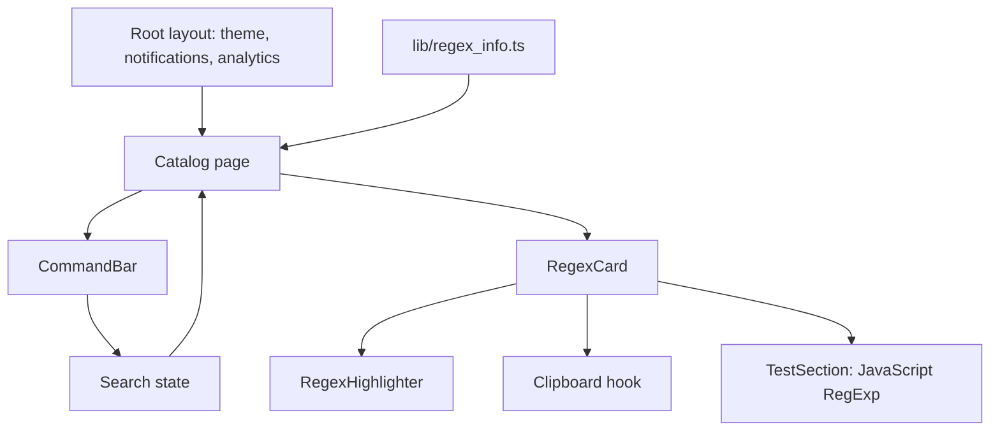

# Architecture

Next.js App Router provides the page and root layout. React state controls search
and each card's test input. Tailwind styles the interface; Radix UI primitives and
cmdk provide dialogs, tooltips, scrolling, and command search. Framer Motion animates
cards and testing panels.

`app/layout.tsx` supplies fonts and shared providers. `app/page.tsx` filters the
catalog. `components/custom/` contains the search, cards, and highlighter;
`components/ui/` contains reusable UI primitives. `lib/hooks/copy.ts` handles copying.
There is no application database or regex-testing API.
