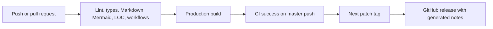

# Automation

CI runs on pushes and pull requests with read-only permissions, a timeout, and
cancellation of superseded runs. Flox supplies the same locked tools used locally.
Bun installs the frozen dependency lockfile before checks and the production build.
Dependabot proposes weekly dependency and GitHub Actions updates.

## Hooks and checks

`pre-commit` runs `bun run check`; `pre-push` runs the production build. CI runs
both commands. Markdownlint validates Markdown and Mermaid CLI renders every
Markdown file containing a Mermaid fence. Rendering fails on invalid diagrams.
Actionlint validates workflow syntax and expressions.

`bun run lint:loc` enforces a 1,300-line application budget and a 80-line automation
script budget. Counts include blank lines and comments in tracked TypeScript,
JavaScript, and CSS files under `app/`, `components/`, `lib/`, and `scripts/`.
Generated files, dependencies, lockfiles, and prose are excluded. Prefer removing
duplication before raising a budget; explain any increase in the change description.

## Releases

After successful CI for a push to `master`, the release workflow checks out that
exact tested commit. It skips stale runs when the branch has moved forward. The
first tag is `v0.1.0`; subsequent releases increment the highest stable tag's patch
number. Tags identify source snapshots independently of `package.json`'s version.

The workflow creates a GitHub release directly because tags pushed with the default
GitHub token do not trigger another workflow. Reruns reuse existing tags and finish
missing releases. Pull requests cannot trigger a release. Releases do not deploy
the application or upload build artifacts.
