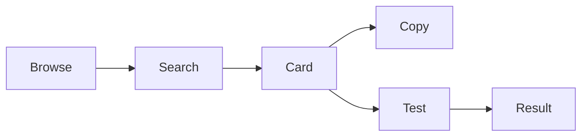

# Using the catalog

Browse the cards or click the search bar. Press **⌘K** on macOS or **Ctrl+K**
elsewhere to toggle search. Search checks titles, descriptions, and pattern text;
titles and descriptions ignore case. Select a result to filter the catalog.
Click the active search bar or press **⌘X / Ctrl+X** to clear the filter.

Click a card's copy icon to copy the raw pattern, without JavaScript delimiters.
Clipboard access requires a secure context such as HTTPS or localhost.

Click the flask icon to open a test input. Nonempty input displays **Matched!**
or **No match** as you type; empty input has no result indicator.

## Matching behavior

The tester uses `new RegExp(pattern).test(input)` in your browser, without flags.
A match may cover only part of the input unless the pattern has anchors (`^`, `$`).
Patterns are curated examples, not comprehensive validators; test representative
valid and invalid inputs before using them in your own application. Other regex
engines can interpret patterns differently. There is no custom-pattern editor.

Test strings are held in component state and tested locally. The app also includes
Vercel Analytics. Reloading clears search and test inputs.
